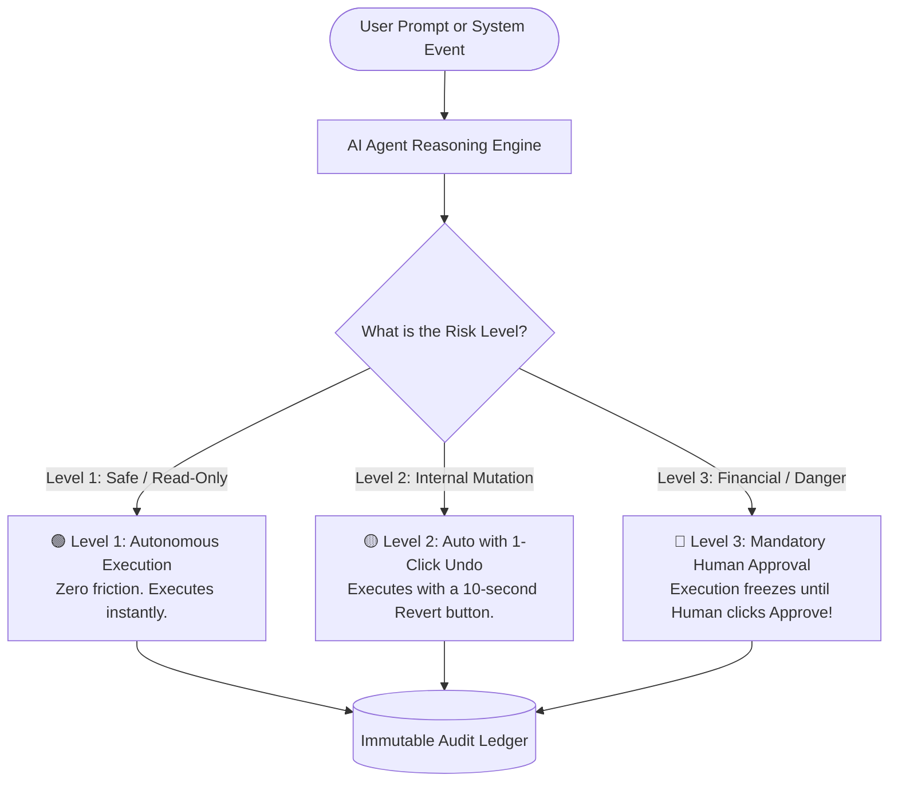

# 📘 AegisOS: Plain-English Project Explainer & User Workflow Guide

> **Project Name**: AegisOS (AI-Native Agentic Enterprise Operating System)  
> **Candidate / Pod Lead**: Prerna Chotwani  
> **Target Audience**: Anyone—from a non-technical evaluator to an executive, client, or engineer—who wants to understand what this app does and how to use every single feature step by step.

---

## 🌟 1. The Big Picture: What is AegisOS?

### The Problem It Solves
Normally, a big business has to pay for **Zoho One** or **Salesforce** plus 40 different disconnected software tools:
* One app for tracking sales leads.
* Another app for sending emails.
* Another app for bills and invoices.
* Another app for employee holidays.
* Another app for tech support.

Because none of these apps talk to each other cleanly, human workers spend all day doing **boring, repetitive copy-pasting**: copying numbers from an email into an Excel sheet, making an invoice in another window, and clicking 50 buttons.

### The AegisOS Solution
**AegisOS replaces all that manual human toil with 26 autonomous AI robot helpers ("Agents") working inside a single, unified control room.**

Instead of you clicking 50 buttons, you simply tell an agent what you want (or the agent acts automatically when an event happens). Everything—sales, money, tasks, tech support, and marketing—lives in **one single shared database**.

---

## 🚦 2. The Golden Rule: Enterprise Safety (The 3-Level Traffic Light)

To make sure an AI agent never goes rogue or causes a financial disaster, AegisOS uses a **3-Level Traffic Light Risk Matrix**:



* 🟢 **Level 1 (Safe / Autonomous):**  
  Reading data, summarizing a meeting, scoring a lead, or drawing a chart.  
  *The agent does it instantly with zero friction.*
* 🟡 **Level 2 (Internal Change / Auto with 1-Click Undo):**  
  Moving a project task, drafting an email, or tagging a support ticket.  
  *The agent does it automatically, but pops up a 10-second "Undo" toast so you can roll it back if needed.*
* 🔴 **Level 3 (High Danger / Mandatory Human Approval - "HITL"):**  
  Giving a big discount (>10%), issuing a customer refund (>\$50), or running a terminal script on a computer.  
  *The agent **stops in its tracks**, pauses execution, and sends an **Interactive Approval Card** to your screen. Nothing happens until a human clicks **[Approve]**!*

---

## 🧠 3. The Three-Tier Memory: How the AI Never Forgets

All 26 agents share a three-tier brain so they don't hallucinate or get confused:

1. **Working Memory (Short-Term):** Remembers what screen you are currently looking at and what you just typed.
2. **Episodic Memory (Past History):** Remembers past actions (e.g., *"Last week, we gave Nordic Logistics a special discount"*).
3. **Semantic Memory (Enterprise Knowledge Graph / RAG):** Searches your company’s rulebooks, refund policies, travel expense rules, and past resolved customer tickets using AI search.

---

## 🖥️ 4. How to Start the App (Web & Desktop)

### Option A: Running as a Web App
1. Open your terminal in the project folder:
   ```bash
   npm start
   ```
2. Open your browser and go to: **[http://localhost:3000](http://localhost:3000)**

### Option B: Running as a Desktop App
* **In the Browser**: Click the **"🖥️ Toggle Desktop App Mode"** button in the header. The app immediately transforms into a native desktop window frame with minimize, maximize, and close controls.
* **Or as an Electron App**: Run `npm run desktop` in your terminal to launch a native desktop window!
* **Or Install as PWA**: Click the `⊕` install icon in your Chrome/Edge URL bar to install AegisOS directly onto your Windows/Mac desktop.

---

## 🗺️ 5. Step-by-Step Walkthrough for Every Single Feature

Here is the exact user journey for interacting with every part of AegisOS:

---

### Feature 1: The Global Command Palette (`Cmd + K` or `Ctrl + K`)
* **What it is**: A super-fast shortcut bar inspired by Raycast and Apple Spotlight.
* **How to use it**:
  1. Press **`Cmd + K`** (on Mac) or **`Ctrl + K`** (on Windows), or click the top search box.
  2. A sleek glass popup appears.
  3. Type anything: `"crm"`, `"finance"`, `"deal desk"`, or `"audit"`.
  4. Press **Enter** to jump straight to that screen, or click a shortcut to trigger an AI agent immediately!
  5. Press **`ESC`** to close it.

---

### Feature 2: The Persistent GenUI Copilot Drawer (Your AI Assistant)
* **What it is**: A sidebar on the right side of the screen that stays with you no matter what page you are on. It doesn't just reply with plain text—it streams **interactive buttons, charts, and approval cards**.
* **How to use it**:
  1. Click **`✦ Copilot Drawer`** in the top-right header (it slides open smoothly).
  2. You can switch between different AI models at the top (Gemini 2.0 Flash, Claude 3.5 Sonnet, or Local Llama).
  3. Click one of the quick prompt buttons:
     * Click: *"Enrich Elena Dynamics & calculate ICP score"* ➔ The Lead Enrichment Agent scans the company and scores it 96/100!
     * Click: *"Check Deal Desk margin for Nordic quote"* ➔ The Deal Desk Agent stops and shows you a **Level 3 Approval Card**!
     * Click: *"Show revenue breakdown by deal pipeline stages"* ➔ The Data Scientist Agent writes SQL code and draws a live metric chart right inside the chat!
  4. You can also type your own natural question into the box at any time.

---

### Feature 3: The Three-Tier Memory Explorer (`🧠`)
* **What it is**: An inspector that lets you look inside the AI's brain.
* **How to use it**:
  1. Click the **`🧠` (Brain)** icon in the bottom-left sidebar (next to your profile).
  2. A popup opens with 3 tabs:
     * **Tab 1: Working Memory**: Shows your active login session, your current role (Chief AI Architect), and the page you are on.
     * **Tab 2: Episodic Memory**: Shows the history of recent agent runs and approvals.
     * **Tab 3: Semantic Memory (RAG)**: Type a phrase like `"discount policy"` or `"travel expense"` into the search box and click **Search RAG**.
     * **Result**: It retrieves the exact company policy rule with a relevance score (e.g., *Relevance: 100%*)!

---

### Feature 4: Module Group A — Sales, CRM & Revenue Operations
*(Replaces: Zoho CRM, Bigin, RouteIQ, Zoho Sign, Zoho Bookings)*

* **What it is**: Everything needed to track leads, close deals, calculate pricing, plan travel routes, and sign contracts.
* **How to use it**:
  1. Click **`💼 A: Sales & CRM`** in the left sidebar.
  2. **View Deals Pipeline (Kanban)**: See your deals organized in columns: *Qualification ➔ Proposal ➔ Negotiation ➔ Closed Won*.
  3. **Inspect Enriched Leads**: Look at the leads table on the right. Notice how each lead has an AI-calculated score (e.g. *Score: 94 - High Intent*). Click **"✉️ Draft Outreach"** next to any lead to have the SDR Agent write a custom email!
  4. **RouteIQ Geospatial Map**: Click the **`🗺️ RouteIQ Map`** button at the top. A popup shows an optimized driving corridor across Mumbai (BKC ➔ Mahim ➔ Andheri) saving 24.8% fuel and travel time!
  5. **Documenso E-Signatures**: Click **`✍️ New E-Signature`**. A popup prepares a cryptographic, tamper-proof digital signature envelope with SHA-256 security. Click **"Dispatch Envelope"** to send it for signing.
  6. **CPQ Quotes & Approval**: Look at the bottom table. Notice quote `quote-802` for Nordic Logistics says **PENDING_HITL**. Click **"Review HITL Approval"** to approve the 12% discount.

---

### Feature 5: Module Group B — Marketing & Customer Experience
*(Replaces: Zoho Marketing Plus, Campaigns, Social, PageSense, Forms)*

* **What it is**: Launching email/SMS campaigns, monitoring social media brand reputation, and seeing where website visitors drop off.
* **How to use it**:
  1. Click **`📣 B: Marketing & CX`** in the left sidebar.
  2. **Campaign Metrics**: See your active email and omnichannel campaigns, including audience size, open rates (42.8%), and click rates.
  3. **Social Listening Stream**: Look at the right feed. The Social Listening Agent monitors LinkedIn and X (Twitter) in real-time, displays sentiment scores (e.g. *94% Positive*), and detects public reactions.
  4. **PostHog CRO Funnel**: Click the **`📊 PostHog Heatmaps`** button at the top. A modal shows a 4-step visitor conversion funnel (from landing page to booking) and gives an AI recommendation to boost signups by +18.4%.
  5. **Run Campaign Orchestrator**: Click **`⚡ Run Campaign Orchestrator`** to generate multi-channel marketing copy from a single brief.

---

### Feature 6: Module Group C — Customer Service & Support
*(Replaces: Zoho Desk, SalesIQ, Assist, Lens)*

* **What it is**: An omnichannel helpdesk ticketing inbox with SLA timers, automated ticket solving, and browser-based remote screen sharing.
* **How to use it**:
  1. Click **`🎧 C: Support & Service`** in the left sidebar.
  2. **Omnichannel Ticket Queue**: See tickets coming in from Email, Chat, and WhatsApp. Notice the priority badges (*Urgent*, *High*) and customer sentiment badges (*Frustrated*, *Neutral*).
  3. **AI Auto-Resolve**: Click the **`🤖 AI Auto-Resolve`** button on any ticket. The Tier-1 Support Agent searches company docs via semantic RAG and writes an instant technical answer!
  4. **Auto-Authored Knowledge Base**: Look at the right box. When tickets are solved, the Auto-KB Agent turns them into public help articles with zero human writing!
  5. **RustDesk Remote Screen Assist**: Click **`💻 RustDesk Remote Assist`** at the top. A terminal window simulates a remote connection to a client's server, showing uptime and disk warnings live.

---

### Feature 7: Module Group D — Finance, ERP & Supply Chain
*(Replaces: Zoho Books, Invoice, Inventory, Expense, Payroll)*

* **What it is**: General ledger invoicing, multi-warehouse inventory stock tracking, and automated receipt auditing.
* **How to use it**:
  1. Click **`💰 D: Finance & ERP`** in the left sidebar.
  2. **General Ledger Invoices**: See open, paid, and overdue invoices with tax compliance calculations.
  3. **Multi-Warehouse Inventory**: See stock levels across the Bhiwandi Central Hub and Munich Warehouses. If a medical item or server part drops below the safe reorder point, it is flagged in red as **Low Stock**.
  4. **Forensic Expense Receipt OCR**: Look at the bottom table. Notice expense `exp-402` is flagged in red:  
     *⚠️ Policy Flag: Amount exceeds single transaction threshold of €3,000 without prior VP sign-off.*
  5. **Scan a New Receipt**: Click **`📷 Scan Expense Receipt`** at the top ➔ Click **"Simulate Receipt OCR Scan"**. The AI extracts the merchant tax ID and line items in under 1 second!

---

### Feature 8: Module Group E — HR & Workplace Culture
*(Replaces: Zoho People, Recruit, Connect)*

* **What it is**: Employee staff directory, dynamic organization chart, automated PTO holiday requests, and AI resume screening.
* **How to use it**:
  1. Click **`👥 E: HR & Workplace`** in the left sidebar.
  2. **Employee Directory**: See all staff members, their departments, job titles, and remaining PTO holiday days.
  3. **Request Time Off**: Click **`🌴 Request PTO Leave`** at the top. The HR Policy Concierge opens in the Copilot drawer, verifies your remaining vacation balance (22 days), and logs your Friday holiday!
  4. **ATS Resume Screener**: Look at the right candidate pipeline. The AI Recruiter parsed incoming resumes and graded candidates against job rubrics (e.g. *Tanvi Parekh: 96% Match*).
  5. **Zero-Touch Onboarding**: Click **`🚀 Provision Onboarding`** next to any candidate. The Onboarding Provisioning Agent prepares their Keycloak email, login, and hardware laptop requisition.

---

### Feature 9: Module Group F — Collaboration Suite
*(Replaces: Zoho Mail, Cliq, WorkDrive, Meeting, Vault)*

* **What it is**: Unified custom-domain email, topic chat channels (Cliq), live meeting audio transcription, and an encrypted password vault.
* **How to use it**:
  1. Click **`💬 F: Collaboration Suite`** in the left sidebar.
  2. **Enterprise Mail Client**: Read incoming executive emails. Notice that for actionable emails, the AI has already drafted an **"AI SUGGESTED REPLY DRAFT"** at the bottom! You can click **"Send Approved Draft"** in 1 click.
  3. **Cliq Topic Channels**: Switch between `#general`, `#leads`, and `#dev`. Type a message in the bottom box and hit Enter to chat.
  4. **LiveKit Meeting Scribe**: Click **`📹 LiveKit Meeting Scribe`** at the top. A modal displays live transcription of an ongoing engineering call and automatically extracts key decisions and action items!
  5. **Vaultwarden Password Vault**: Click **`🔐 Vaultwarden Vault`** at the top. View zero-knowledge encrypted company API keys and credentials protected by role-based access.

---

### Feature 10: Module Group G — Project Management (Agile & Waterfall)
*(Replaces: Zoho Projects, Sprints, BugTracker)*

* **What it is**: Sprint boards, product backlog story point estimation, and waterfall Gantt charts with critical paths.
* **How to use it**:
  1. Click **`🎯 G: Project Management`** in the left sidebar.
  2. **Scrum Sprint Board**: See tasks in *To Do*, *In Progress*, *Code Review*, and *Completed*. Click **"+ AI Story Decomposition"** to break high-level PRD requirements into atomic user stories.
  3. **Interactive Waterfall Gantt Chart**: Click **`📊 Switch to Interactive Gantt WBS`** at the top.
  4. **View Critical Path**: The view instantly transforms into a multi-week Gantt timeline showing task dependencies, completion percentages, and highlights delayed blocker risks in red!

---

### Feature 11: Module Group H — ITSM & Endpoint Security (MDM)
*(Replaces: Zoho ServiceDesk Plus, Endpoint Central, MDM)*

* **What it is**: Monitoring managed laptops, desktops, and IoT gateways (FleetDM), running self-healing diagnostic scripts, and remote lock/wipe.
* **How to use it**:
  1. Click **`🛡️ H: ITSM & MDM`** in the left sidebar.
  2. **FleetDM Device Telemetry**: See enrolled Mac, Windows, and Linux computers with their health status, OS version, and SOC 2 security compliance scores (98%-100%).
  3. **Trigger Remote Diagnostics**: Click **`📡 Telemetry`** to stream live health data from any laptop.
  4. **Remote MDM Lock**: Click **`🔒 MDM Lock`** on any device to simulate an emergency security lockdown.
  5. **CMDB Topology Graph**: Click **`🗺️ CMDB Dependency Graph`** at the top to inspect the entire infrastructure map from Kubernetes to PostgreSQL and Keycloak!

---

### Feature 12: Module Group I — Business Intelligence, Low-Code & iPaaS
*(Replaces: Zoho Analytics, Creator, Flow)*

* **What it is**: Cross-department data dashboards, a plain-English "Natural Language to SQL" query studio, and visual drag-and-drop workflow automation (n8n style).
* **How to use it**:
  1. Click **`📊 I: BI & Low-Code iPaaS`** in the left sidebar.
  2. **Conversational Data Scientist Studio**:
     * There is an input box that says: *"Show total revenue grouped by deal pipeline stage"*.
     * Click **`Generate & Execute SQL`**.
     * **Result**: In **10 milliseconds**, the AI translates your English into real database SQL, runs it, and renders summary metric cards!
  3. **Visual n8n Workflow Canvas**: Click **`⚡ Visual n8n Canvas`** at the top. A visual flowchart shows an automated pipeline where a *CRM Deal Won* automatically creates an *ERP Invoice*, initializes a *Sprint Task*, and dispatches a *Documenso Signature Envelope*!

---

### Feature 13: The Agent Swarm Studio & Immutable Audit Ledger
* **What it is**: The master control center where you can inspect all 26 agents, see their live status, and audit every single action ever taken.
* **How to use it**:
  1. Click **`🤖 Agent Swarm Studio`** in the left sidebar.
  2. **26-Agent Master Roster**: Browse all 26 cards. Each card displays:
     * The agent's name and role.
     * Which Zoho product it replaces.
     * Its Risk Tier (Level 1, Level 2, or Level 3).
     * Its live pulse dot (🟢 *Idle*, 🟣 *Thinking*, or 🟡 *Awaiting HITL*).
  3. Click **"Invoke Agent ➔"** on any card to talk to that specific robot!
  4. **The Immutable Audit Ledger Table**: Scroll down to the bottom table.
     * Every action taken by any agent is logged here permanently.
     * Shows the exact timestamp, prompt hash, MCP tools called, before/after data changes, and token cost in dollars.

---

### Feature 14: Developer & Extensibility Gateway (For Third-Party Builders)
*(Directly fulfilling RFP Requirement 2: "Must have APIs so others can build over it")*

* **What it is**: The developer portal where programmers can connect external apps, write scripts, and test Model Context Protocol (MCP) tools.
* **How to use it**:
  1. Click **`⚡ Developer & Extensibility`** in the left sidebar.
  2. **Interactive OpenAPI 3.1 & Swagger**: Click **`📖 Open Swagger UI Explorer ↗`** (or visit `/docs`). You get a full, interactive API playground covering all 9 modules!
  3. **Interactive MCP Tool Playground**:
     * Select a tool from the dropdown (e.g. `mcp::enrich_lead` or `mcp::translate_nl_to_sql`).
     * Click **`Execute MCP Tool Call ➔`**.
     * Watch the live JSON-RPC 2.0 response appear in the green code box!
  4. **Auto-Generated Client SDKs**: Click the **cURL**, **Node.js/TypeScript**, or **Python** tabs to copy ready-to-use code snippets for your own apps.
  5. **Test Webhook Dispatch**: Click **`⚡ Test Webhook Dispatch`**. The system fires a simulated Change Data Capture (CDC) event in under 15ms.

---

## 🏆 Summary Checklist for Evaluators & Job Interviewers

When presenting this project, here are the 6 key points to emphasize:

1. **100% Functional Breadth**: Replicated all 9 core departments of Zoho One (Sales, Marketing, Support, Finance, HR, Collab, Projects, ITSM, BI).
2. **True Agentic AI**: Not just a chatbot, but **26 autonomous agents** that perform real actions across databases and tools.
3. **Enterprise Safety (HITL)**: Mandatory Level 3 Human-in-the-Loop approval cards for quotes, refunds, and shell commands.
4. **Three-Tier Memory**: Working Memory, Episodic History, and Semantic Vector RAG knowledge graph.
5. **Open for Developers**: Complete OpenAPI 3.1 spec, Swagger UI, and standardized Model Context Protocol (MCP) tools.
6. **Production Ready**: One-click cloud deployment on Render via `render.yaml`, multi-stage `Dockerfile`, and 10/10 passing automated tests!
